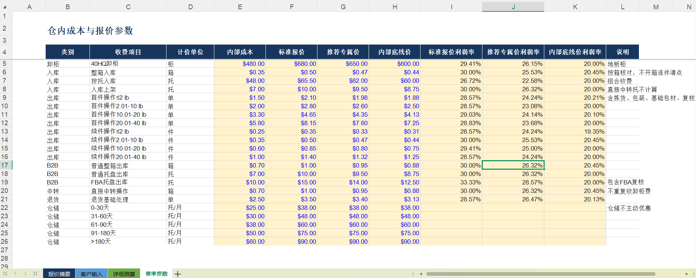
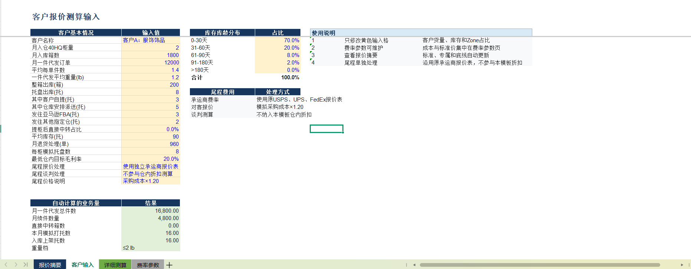
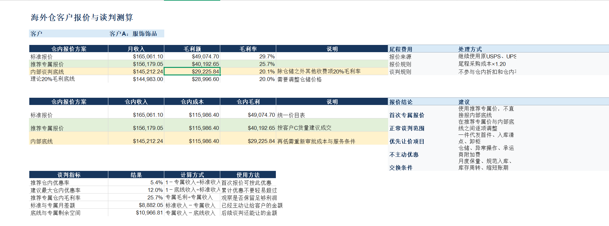
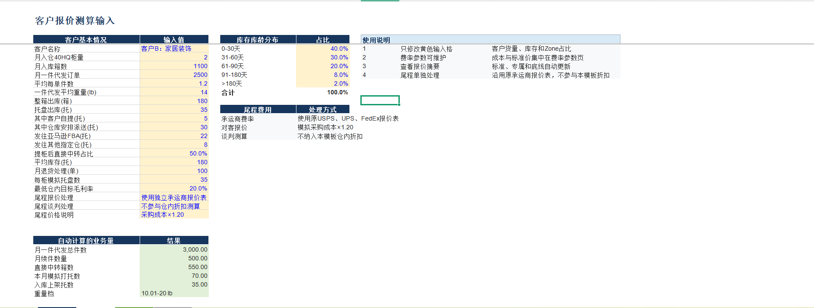
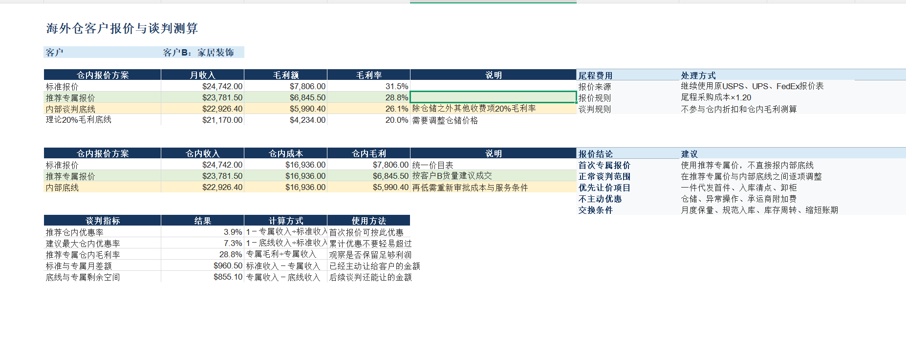
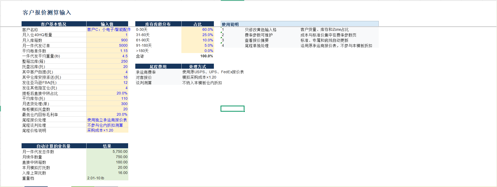
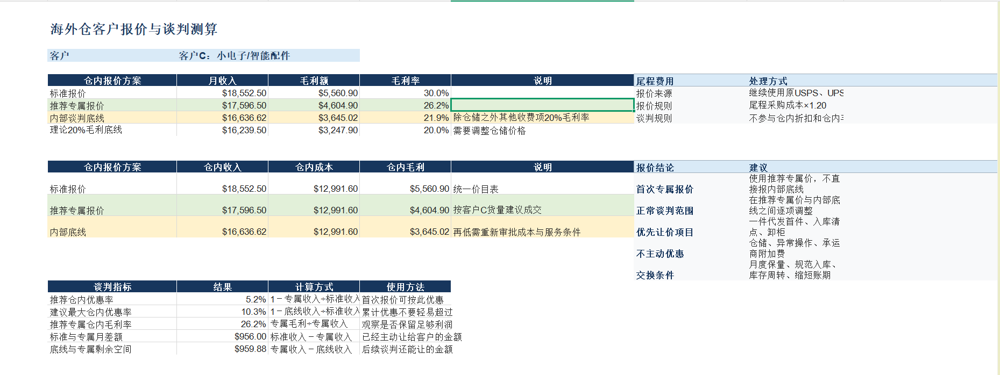

# Overseas-Warehouse-Pricing-Model
海外仓报价模拟：基于模拟客户数据，测算仓内操作、仓储及尾程费用，分析客户利润与折扣空间。
# 海外仓客户报价与谈判测算模型

## 项目介绍

使用Excel搭建海外仓客户报价模拟模型，根据客户的入库量、出库订单量、商品重量、平均库存和库龄分布，测算不同报价方案下的仓内收入、成本、毛利额与毛利率，为客户报价和折扣谈判提供参考。

本项目使用模拟客户与假设成本参数，不代表真实企业报价或行业统一成本。

当前公开展示项目说明及截图，完整Excel模型暂不公开。

## 一、业务范围与测算口径

模型涵盖卸柜、入库、上架、一件代发首件与续件操作、整箱及托盘出库、FBA托盘出库、直接中转、退货基础处理和仓储费用。

设置三档报价：

- 标准报价：作为统一报价的参照。
- 推荐专属报价：用于模拟首次向客户提供的优惠方案。
- 内部谈判底线：用于评估进一步让价的空间，不直接作为首次报价。

仓储按库龄分档计费，本版模型设定仓储单价不随上述报价档位主动优惠。

尾程运费单独处理，不纳入本页仓内折扣与毛利测算。尾程模拟售价采用采购成本×1.20，即成本加价20%，并非毛利率20%。

本项目所示毛利按模型设定的成本口径计算，不等同于仓库净利润。

### 成本与报价参数

集中维护各项服务的模拟单位成本、标准报价、推荐专属价及内部底线价。

## 二、客户A：服饰饰品

### 客户输入

模拟月一件代发12,000单，平均每单1.4件，平均重量1.2磅，平均库存90托，并包含整箱、托盘出库及退货处理业务。

输入客户货量与库龄分布，计算相应的作业量。

### 报价与谈判结果

对比标准报价、推荐专属报价及内部谈判底线下的收入与毛利，展示首次优惠幅度、累计优惠空间和后续谈判可让金额。

## 三、客户B：家居装饰

### 客户输入

模拟月一件代发2,500单，平均每单1.2件，平均重量14磅，平均库存180托，提柜后直接中转占比50%。

用于观察较重商品、较高库存与中转业务组合对报价结果的影响。

### 报价与谈判结果

对比不同方案的仓内毛利，并区分“保持仓储单价的内部谈判底线”与“理论20%毛利底线”。

理论底线仅作为测算参照，不直接等同于可执行报价。

## 四、客户C：小电子／智能配件

### 客户输入

模拟月一件代发5,000单，平均每单1.15件，平均重量4.5磅，平均库存110托，提柜后直接中转占比20%。

结合一件代发、FBA补货及其他出库业务，测算混合业务客户的报价。

### 报价与谈判结果

展示推荐专属价对应的毛利水平，以及从推荐价继续调整至内部底线的谈判空间。

让价需结合月度保量、入库规范、库存周转及账期等条件综合判断。

## 五、项目价值与使用边界

将客户业务量、单位成本和报价规则连接起来，使折扣谈判能够对应到具体的收入与毛利变化。

实际应用时，需要替换为企业真实成本、合同费率和客户数据，并校验计费单位、收费项目是否重复、库龄分布及额外作业要求。
